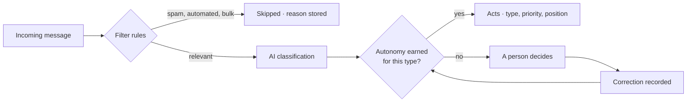

<p align="center">
  
</p>

**AI support triage for the support inbox.** Every message is classified on arrival; the AI acts alone only where it has earned the right to, and hands the decision to a person when it hasn't.

[Website](https://kairo.alejojamc.com) · [What works today](docs/what-is-kairo.md) · [Español](docs/README.es.md)

<p align="center">
  
  
  
</p>

## What it does

- **Classifies every message on arrival** — type, priority, urgency and tone — before anyone opens the inbox.
- **Orders the queue** by ticket type, customer plan, mood, waiting time and recurrence, so the first screen is the work order.
- **Earns its autonomy per customer.** A ticket type is auto-approved only after measured accuracy, and a correction takes that right away again.

## How a message becomes a ticket



## Status

| State | What it covers |
|---|---|
| **Working today** | Gmail ingestion · classification · priority queue · replies in-thread · internal notes · escalations · response-time targets |
| **Built, off by default** | Knowledge proposals · ticket assistant · second model · contact drafts · acknowledgement email |
| **Not built** | Channels beyond Gmail · billing · auto-resolution |

What works, what is switched off, and where the marketing site promises more than the product does: **[docs/what-is-kairo.md](docs/what-is-kairo.md)**.

## Quickstart

Requires Bun 1.3+, a Supabase project, Google OAuth credentials, and an AI Gateway key (or local Ollama).

```bash
bun install
cp .env.example .env.local   # fill in the values
bun run dev                  # api :3001 · dashboard :5173 · landing :3000 · kelan :3002
bun run dev:inngest          # Inngest dev server for the pipeline (separate terminal)
```

```bash
bun test        # unit and integration tests
bun run build   # turbo build across the monorepo
```

Every variable is validated at startup by [`@kairo/env`](packages/env/index.ts); see [`.env.example`](.env.example) for the full list.

## Architecture

```
apps/
  api/          Bun + Hono · REST v1 + Inngest pipeline (tiers, polling, retries)
  dashboard/    Vite + React 19 · the cockpit
  landing/      Next.js 15 · marketing site, auth, onboarding wizard
  kelan/        Next.js 15 · internal admin
  mobile/       Expo · scaffold only
packages/       shared libraries; the AI layer is intelligence/ (AI SDK, model roles, prompts)
supabase/
  migrations/   schema, RLS, append-only history
```

## Evals

The part worth reading: a bench of hand-labelled emails scored against the same pipeline production runs, per field rather than pass/fail. Several design decisions in this repo — trusting the mail server's spam verdict, splitting buyers from sellers, auto-approving only `support` at first — came out of these numbers.

```bash
bun run eval:pipeline   # emails through the classifier → CSV
bun run eval:metrics    # F1, calibration and tone inflation per label
```

The corpora are private and are not in this repository.

## Docs

| Document | What it covers |
|---|---|
| [what-is-kairo.md](docs/what-is-kairo.md) | What the product does today, plainly |
| [que-es-kairo.md](docs/que-es-kairo.md) | The same, in Spanish |
| [ai-engineering/](docs/ai-engineering/) | Capability map, skills and tools |
| [observability.md](docs/observability.md) | Langfuse + ClickStack |
| [versioning.md](docs/versioning.md) | How rules and prompts are versioned |

## Contributing

Open an issue before a large change. Commits use [Conventional Commits](https://www.conventionalcommits.org/); user-facing strings need both English and Spanish.

## License

[Apache-2.0](LICENSE).
