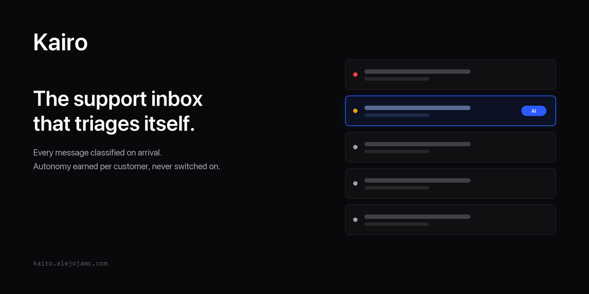
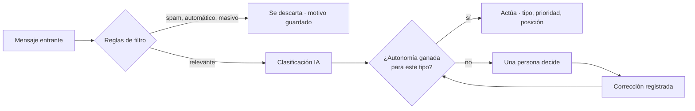

<p align="center">
  
</p>

**Triage de soporte con IA para la bandeja de soporte.** Cada mensaje se clasifica al llegar; la IA actúa sola solo donde se ha ganado el derecho, y le pasa la decisión a una persona cuando no.

[Sitio web](https://kairo.alejojamc.com) · [Qué funciona hoy](que-es-kairo.md) · [English](../README.md)

<p align="center">
  
  
  
</p>

## Qué hace

- **Clasifica cada mensaje al llegar** — tipo, prioridad, urgencia y tono — antes de que nadie abra la bandeja.
- **Ordena la cola** por tipo de ticket, plan del cliente, estado de ánimo, tiempo de espera y reincidencia, para que la primera pantalla sea el orden de trabajo.
- **Se gana la autonomía por cliente.** Un tipo de ticket se aprueba automáticamente solo tras medir su precisión, y una corrección le quita ese derecho otra vez.

## Cómo un mensaje se convierte en ticket



## Estado

| Estado | Qué incluye |
|---|---|
| **Funciona hoy** | Entrada desde Gmail · clasificación · cola por prioridad · respuestas en el hilo · notas internas · escalamientos · tiempos de respuesta |
| **Construido, apagado por defecto** | Propuestas de conocimiento · asistente del ticket · segundo modelo · borradores de contactos · correo de acuse |
| **Sin construir** | Canales distintos de Gmail · facturación · resolución automática |

Qué funciona, qué está apagado y dónde el sitio de marketing promete más de lo que hace el producto: **[what-is-kairo.md](what-is-kairo.md)**.

## Primeros pasos

Requiere Bun 1.3+, un proyecto de Supabase, credenciales de Google OAuth y una clave de AI Gateway (u Ollama local).

```bash
bun install
cp .env.example .env.local   # completa los valores
bun run dev                  # api :3001 · dashboard :5173 · landing :3000 · kelan :3002
bun run dev:inngest          # servidor de Inngest para el pipeline (otra terminal)
```

```bash
bun test        # pruebas unitarias y de integración
bun run build   # compila todo el monorepo con turbo
```

Cada variable se valida al arrancar con [`@kairo/env`](../packages/env/index.ts); la lista completa está en [`.env.example`](../.env.example).

## Arquitectura

```
apps/
  api/          Bun + Hono · REST v1 + pipeline Inngest (tiers, sondeo, reintentos)
  dashboard/    Vite + React 19 · el panel
  landing/      Next.js 15 · sitio de marketing, auth, asistente de registro
  kelan/        Next.js 15 · administración interna
  mobile/       Expo · solo esqueleto
packages/       librerías compartidas; la capa de IA es intelligence/ (AI SDK, roles de modelo, prompts)
supabase/
  migrations/   esquema, RLS, historial append-only
```

## Evaluaciones

La parte que importa: un banco de correos etiquetados a mano, puntuados contra el mismo pipeline que usa producción, campo por campo y no solo acierto o fallo. Varias decisiones de este repositorio — creerle al veredicto de spam del servidor, separar a quien compra de quien vende, aprobar automáticamente solo `support` al principio — salieron de estos números.

```bash
bun run eval:pipeline   # correos por el clasificador → CSV
bun run eval:metrics    # F1, calibración e inflación de tono por etiqueta
```

Los corpus son privados y no están en este repositorio.

## Documentación

| Documento | Qué cubre |
|---|---|
| [what-is-kairo.md](what-is-kairo.md) | Qué hace el producto hoy, en claro |
| [que-es-kairo.md](que-es-kairo.md) | Lo mismo, en español |
| [ai-engineering/](ai-engineering/) | Mapa de capacidades, skills y herramientas |
| [observability.md](observability.md) | Langfuse + ClickStack |
| [versioning.md](versioning.md) | Cómo se versionan reglas y prompts |

## Contribuir

Abre un issue antes de un cambio grande. Los commits usan [Conventional Commits](https://www.conventionalcommits.org/); los textos de interfaz necesitan inglés y español.

## Licencia

[Apache-2.0](../LICENSE).
